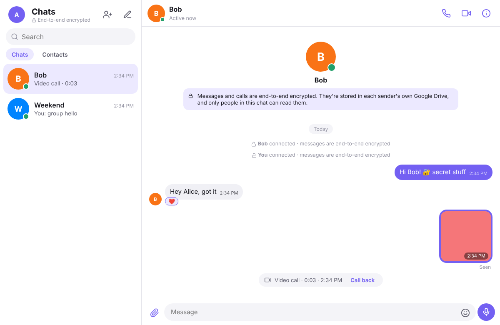
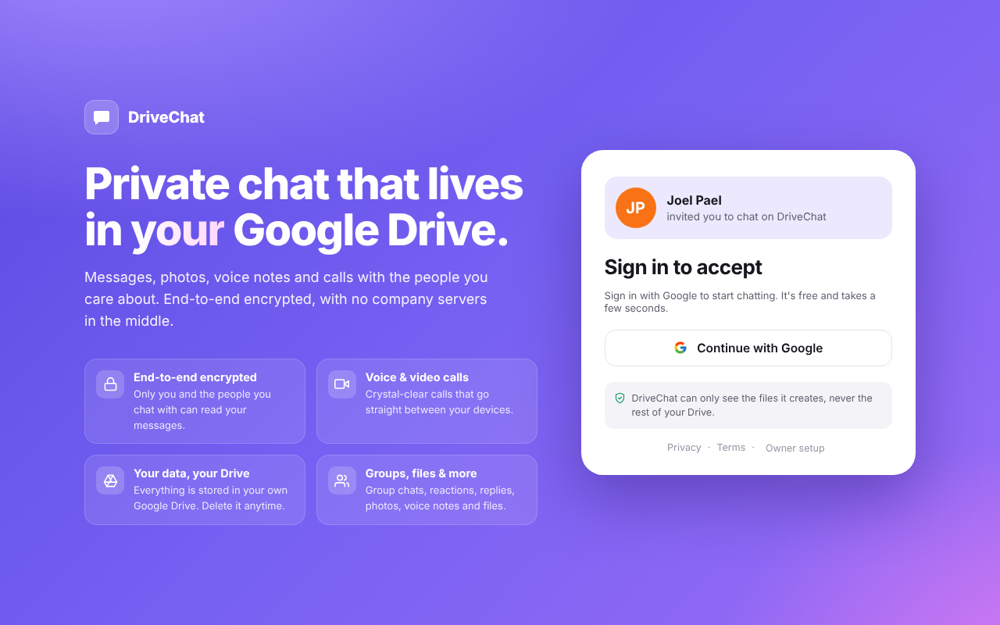
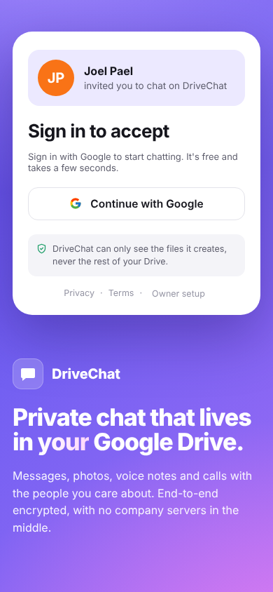
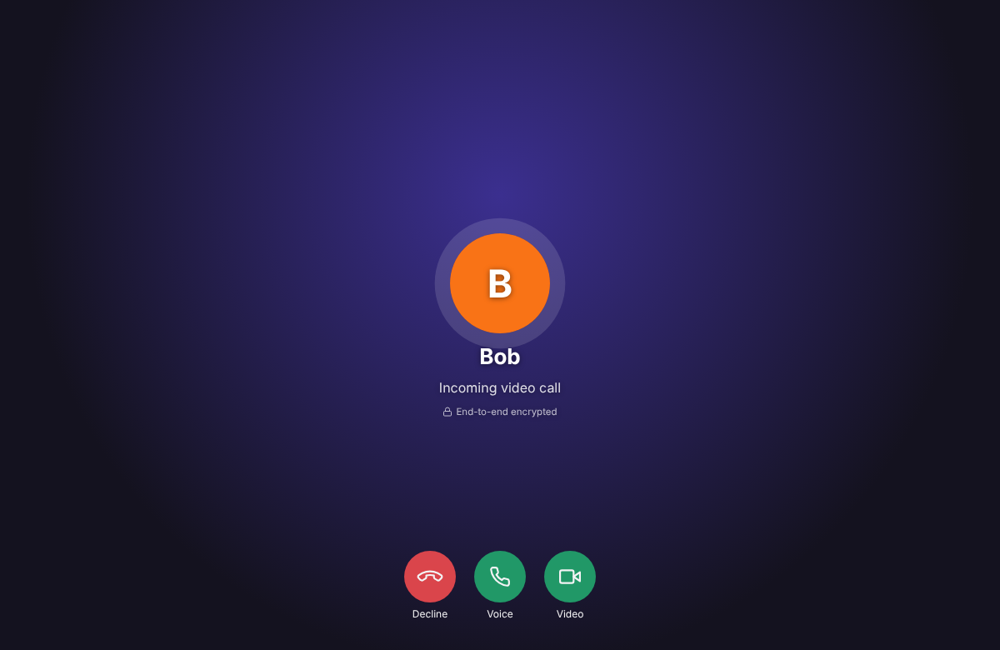

# DriveChat

**Private chat that lives in your own Google Drive.**

End-to-end encrypted messages, photos, voice notes and voice/video calls, with no company servers in the middle.

[**Open DriveChat →**](https://drivechat-7nzd.onrender.com)

## Features

| | |
|---|---|
| 🔒 **End-to-end encrypted** | Messages, photos, files, voice notes, read receipts and typing are encrypted on your device. |
| 📞 **Voice & video calls** | One-to-one calls that go straight between devices, also encrypted. |
| 💬 **Everything you expect** | Groups, replies, reactions, edits, deletes, read receipts, typing indicators and online status. |
| 📁 **Your data, your Drive** | Everything is stored in a `DriveChat` folder in your own Google Drive. Delete it any time. |
| 🛡️ **Minimal permissions** | DriveChat can only see the files it creates, never the rest of your Drive. |
| 📱 **Works everywhere** | Desktop and mobile browsers. Add it to your home screen and it runs like an app. |

&nbsp;&nbsp;

## How to use it

1. Open the app and **sign in with Google**.
2. Create a **backup password**. It protects your encryption key, so you can read your chats on other devices.
3. Tap **Add people** and send your invite link to a friend.
4. When they open it and sign in, you're connected.

## How it works

DriveChat is a single static web page with no backend.

- **Storage.** Each person keeps an encrypted *outbox* folder in their own Google Drive. Friends' apps read it to receive messages.
- **Encryption.** Every user has a P-256 key pair. Each one-to-one chat uses an AES-256-GCM key agreed between the two people's key pairs (ECDH), so the key never travels anywhere. Each group gets a random key that's shared through members' encrypted one-to-one chats. A per-chat *security code* lets two people confirm nobody is intercepting.
- **Calls.** Call setup messages are encrypted and passed through Drive. The audio and video then go peer-to-peer over WebRTC, encrypted with DTLS-SRTP.
- **Permissions.** The app uses Google's `drive.file` permission, which only covers files the app itself creates.

## Self-hosting

Want your own copy? Follow these steps:

1. In [Google Cloud Console](https://console.cloud.google.com/), create a project and enable the **Google Drive API**.
2. Set up **Google Auth Platform**:
   - **Branding:** set the app name, support email, your domain, and the privacy and terms links.
   - **Audience:** set it to *External*, then click **Publish app**.
3. **Clients → Create client → Web application.** Add your site's address under *Authorized JavaScript origins*.
4. **Credentials → Create API key.** Restrict it to the Google Drive API and to your website.
5. Paste both values into `CONFIG` at the top of `index.html`.
6. Host the files on any static host, such as GitHub Pages, Netlify, Render or Vercel.

| File | What it is |
|---|---|
| `index.html` | The whole app |
| `privacy.html`, `terms.html` | Privacy policy and terms of service |
| `manifest.webmanifest`, `icon-*.png` | Lets people install the app on their home screen |
| `og.png` | The preview image shown when the link is shared |

## Good to know

- **Some calls won't connect.** On very strict networks, peer-to-peer calls can fail. Adding a TURN server to `CONFIG.iceServers` fixes this.
- **Work and school accounts.** Some Google Workspace admins block link sharing, which DriveChat needs. Personal Gmail accounts always work.
- **Lost backup passwords can't be recovered.** If you lose it and every signed-in device, older messages can't be decrypted.

[Privacy Policy](https://drivechat-7nzd.onrender.com/privacy.html) · [Terms of Service](https://drivechat-7nzd.onrender.com/terms.html)
