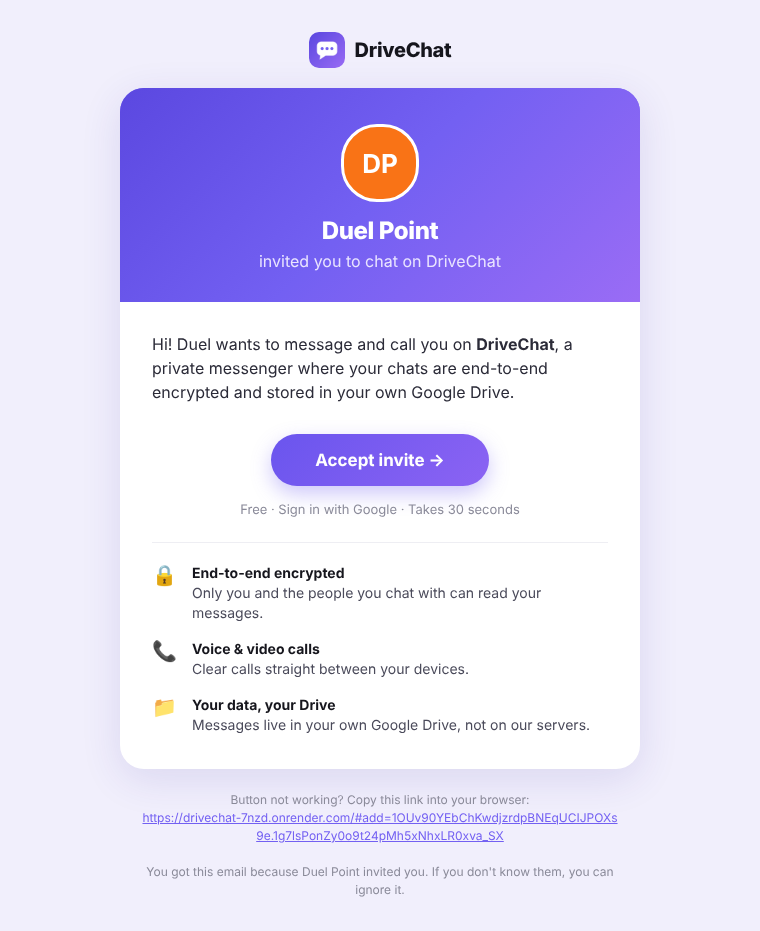

# Push relay: notifications when DriveChat is closed

DriveChat has no server, so on its own it can only notify you while the app is open. Messenger-style notifications for messages and incoming calls, delivered while the app is closed or the phone is locked, need this tiny relay. It runs free on Cloudflare Workers and takes about 3 minutes to set up once.

**Privacy.** Each notification is encrypted in the sender's browser for the recipient's device (the Web Push standard, RFC 8291). The relay can't read who is messaging or what they wrote. It only adds the app's signature, which Google and Apple require, and passes the notification on.

## Setup
1. Sign up free at <https://dash.cloudflare.com>.
2. Go to **Workers & Pages → Create → Create Worker**. Name it `drivechat-push`, then click **Deploy**.
3. Click **Edit code**, delete everything there, and paste in the **ready-made `worker-ready.js`** you were given. It already contains your keys.
   - If you're starting from `worker.js` in this folder instead, fill in the three constants at the top first.
4. Click **Deploy**. Open the Worker's URL (e.g. `https://drivechat-push.yourname.workers.dev`) in your browser. You should see `"ok": true`.
5. In `index.html`, set:
   ```js
   pushRelay: 'https://drivechat-push.yourname.workers.dev',
   ```
   Commit the change; Render redeploys automatically.
6. Each person taps **Turn on notifications** in DriveChat.

## Automatic contacts (strongly recommended)
When a friend opens your invite link, this lets YOUR app add them automatically. Without it, they'd have to send their link back to you.

1. In Cloudflare, go to **Storage & databases → KV → Create**, name it `drivechat-contacts`, and click **Add**.
2. Open the `drivechat-push` Worker → **Bindings → Add binding → KV namespace**.
3. Set **Variable name** to `HS` (capital letters) and **KV namespace** to `drivechat-contacts`, then click **Add binding** / **Deploy**.
4. Open the Worker URL. It should now show `"hs": true`.

The relay only stores "someone accepted invite X; their DriveChat folder ID is Y" (no names, no messages), and each entry deletes itself after 30 days. This fits easily in Cloudflare's free tier.

## Keep the private key secret
`worker-ready.js` contains your VAPID **private** key. Paste it only into Cloudflare, and never commit it to GitHub. The `worker.js` in this repo has no keys in it.

If the key ever leaks, generate a new key pair. Update `VAPID_PUBLIC_KEY` and `VAPID_PRIVATE_JWK` in the Worker and `CONFIG.vapidPublicKey` in `index.html`. Users' devices re-subscribe automatically.

## What works where
| Device | Messages & calls while DriveChat is closed |
|---|---|
| Android (Chrome, Edge, Samsung Internet) | ✅ Works whether or not the app is installed |
| Windows / Mac / Linux (Chrome, Edge, Firefox) | ✅ Works while the browser is running. Chrome on Windows and Mac keeps running in the background by default. |
| iPhone / iPad (iOS 16.4 or later) | ✅ Only after **Add to Home Screen**. Open DriveChat from the Home Screen icon, then turn on notifications. |

An incoming call shows a notification with **Answer** and **Decline** that stays on screen until you respond. The notification plays your phone's notification sound once and vibrates in a long pattern, rather than ringing continuously like a native phone call. Web apps aren't allowed to use the full-screen call ringer.

## Optional: branded invite emails

The app never sends Google Drive "shared a folder" emails. Without this setup, **Invite → Email** opens your own Gmail or mail app with a ready-written invite. To have DriveChat send a polished email itself, with your photo and an **Accept invite** button:



1. **Get a domain** (any registrar, ~$10/year; Cloudflare Registrar is cheapest).
2. **Set up Resend.** Create a free account at <https://resend.com> (3,000 emails/month free). Under **Domains**, add your domain and add the DNS records it shows.
3. **Create an API key** in Resend.
4. **Add two variables to the Worker.** In Cloudflare, open the `drivechat-push` Worker → **Settings → Variables and Secrets** and add:
   - `RESEND_API_KEY`: your Resend API key (choose type **Secret**)
   - `EMAIL_FROM`: e.g. `DriveChat <invite@yourdomain.com>`
5. **Deploy.** Opening the Worker URL should now show `"email": true`. The app switches to branded emails automatically.

Each sender can send up to 12 invites an hour, and invites only work for links to your own DriveChat site.
